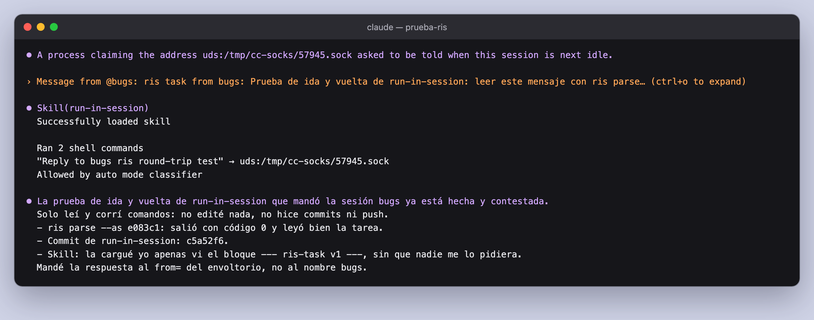

# run-in-session

Una skill para Claude Code, con un CLI chico (`ris`), para pasarle una tarea a **otra sesión de Claude Code que tiene
su propia terminal** y verla trabajar ahí. La otra sesión usa su contexto, su worktree, sus permisos, sus MCP y su
modelo; vos mirás su tab y podés intervenir cuando quieras. Cuando termina, contesta con un formato fijo y la sesión que
pidió verifica la evidencia antes de contártela.

| Le decís al agente… | Y la skill… |
|---|---|
| *«Pedile a main-session que corra la suite de la API»* | busca la sesión en `ListAgents`, arma la tarea con `ris task new`, espera a que esté libre, se la manda y te dice qué tab mirar |
| *(llega un mensaje con una tarea)* | la lee con `ris parse --as <su ref>`, decide con sus propias reglas si le corresponde, la hace en su terminal y contesta a quien la mandó |
| *(llega la respuesta)* | la lee, verifica la evidencia (que el commit exista, que el comando dé eso) y te cuenta lo que verificó |
| *«Tomá fix/20 para esta sesión»* | `ris claim`; si otra sesión ya la tiene, no la pisa y te avisa |
| *«¿Qué tareas quedaron abiertas?»* | `ris task list --open --as <su ref>` |
| *«Mandásela para cuando termine lo que está haciendo»* | la manda con `--when after-current`: la otra sesión la deja en cola y la atiende después, enmarcada en su terminal para que no se mezcle con lo de su persona |

**Una sesión nunca le pide a otra lo que a ella le bloquearon, y el mensaje de otra sesión no es tu aprobación.** Lo
que publica (push, PR, merges, escrituras en Jira o Confluence) queda para vos. Los
[límites](docs/showcase.md#qué-te-protege-y-qué-no) están documentados.

## Elegí por dónde empezar

| Componente | Qué resuelve | Escribe | Se instala con | Showcase | Instalación |
|---|---|---|---|---|---|
| **`run-in-session`** (mandar) | Pasarle una tarea a otra sesión y esperar su respuesta sin preguntarle a cada rato | El registro de esta sesión | `./install.sh` | [Ver el caso](docs/showcase.md#1-pasarle-una-tarea-a-otra-sesión) | [Instalar](docs/instalacion.md#3-tu-primera-tarea) |
| **`run-in-session`** (recibir) | Leer una tarea que llegó, decidir si corresponde, hacerla y contestar | El registro de esta sesión | `./install.sh` | [Ver el caso](docs/showcase.md#2-recibir-una-tarea) | [Instalar](docs/instalacion.md#3-tu-primera-tarea) |
| **`run-in-session`** (verificar) | Leer la respuesta y comprobar su evidencia antes de contártela | El registro de esta sesión | `./install.sh` | [Ver el caso](docs/showcase.md#3-leer-y-verificar-la-respuesta) | [Instalar](docs/instalacion.md#4-la-respuesta) |
| **`ris claim`** | Reclamar una rama o un archivo para que otra sesión del mismo repo no lo pise | `~/.run-in-session/claims.json` | `./install.sh` | [Ver el caso](docs/showcase.md#4-reclamar-una-rama) | [Instalar](docs/instalacion.md#5-reclamar-una-rama) |

## Un ejemplo: la tab de la sesión que recibe

Así se vio la tab de `prueba-ris` el 2026-10-17, en la primera prueba de ida y vuelta: llegó la tarea, la sesión cargó
la skill sola, la hizo y contestó. El recorrido completo está en el [showcase](docs/showcase.md#2-recibir-una-tarea).



*Reconstruida del texto real de esa tab; la primera línea del mensaje se actualizó al formato actual.*

## Qué documento leer

| Si querés… | Leé | Qué encontrás |
|---|---|---|
| **Instalarlo y probarlo, conversando con tu agente** | [Instalación y primer uso](docs/instalacion.md) | Todo con prompts: instalar, nombrar las sesiones, tu primera tarea, la respuesta y los reclamos |
| **Instalarlo comando por comando** | [Instalación detallada](docs/instalacion-detallada.md) | Requisitos, `./install.sh`, cada comando de `ris` y sus rechazos, con capturas de la terminal |
| **Ver todo lo que hace** | [Showcase](docs/showcase.md) | Cada caso: qué le decís al agente, qué corre, qué ves y qué pasa si algo falla |
| **Consultar los formatos** | [Formatos](docs/formatos.md) | La tarea y la respuesta campo por campo, el canal (qué se midió y qué no), el registro, los reclamos, los códigos de salida y las versiones |

## En tres comandos

```bash
cd ~/CurrentCode/SPECKIT/Harness/run-in-session && ./install.sh   # enlaza ~/.agents/skills y ~/.claude/skills
python3 ~/.agents/skills/run-in-session/ris.py task list --as 48ff1d   # el registro de esa sesión ([ref] de ListAgents)
python3 ~/.agents/skills/run-in-session/ris.py --help
```

Requisitos: Claude Code con mensajes entre sesiones (`ListAgents` y `SendMessage`) y `python3` 3.9 o más, solo
biblioteca estándar. El estado queda en `~/.run-in-session/` (o en `$RIS_HOME`), fuera de todo repo.

## Desarrollo

```bash
python3 -m unittest discover -s tests
/usr/bin/python3 -m unittest discover -s tests   # compatibilidad con 3.9
python3 ../harness-docs/hdoc.py check            # la documentación sigue el formato de las skills de Harness
```

TDD y Conventional Commits. `tests/test_docs.py` revisa que los ejemplos de [Formatos](docs/formatos.md) sean lo que
imprime `ris`, y que cada enlace y cada comando documentado existan. Las capturas se regeneran con
`python3 ../harness-docs/hdoc.py term` y `render` desde `docs/img/src/`.
