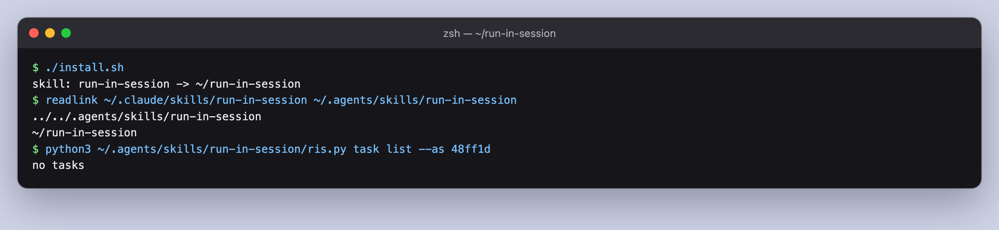
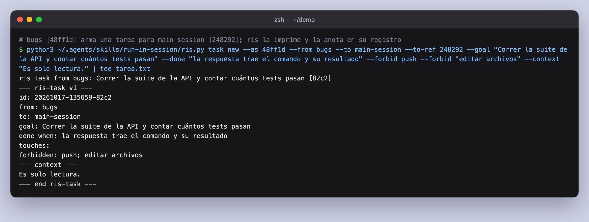
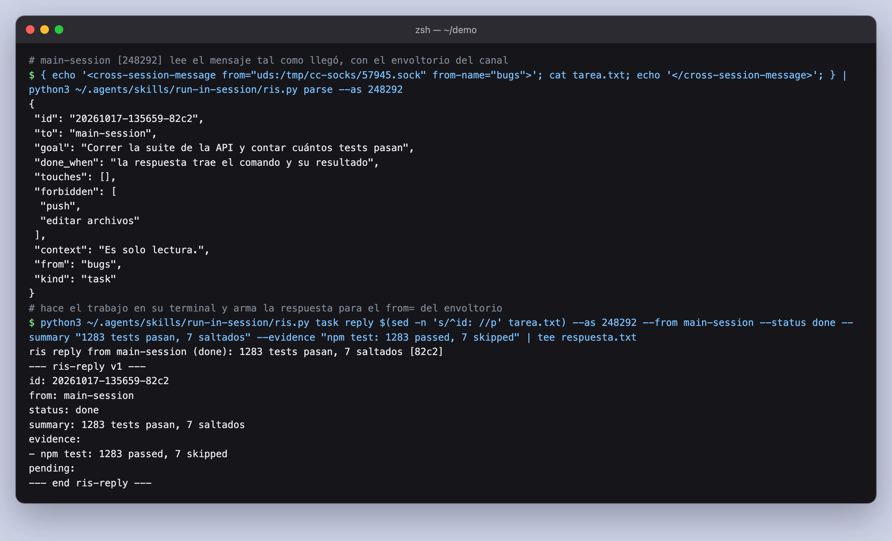
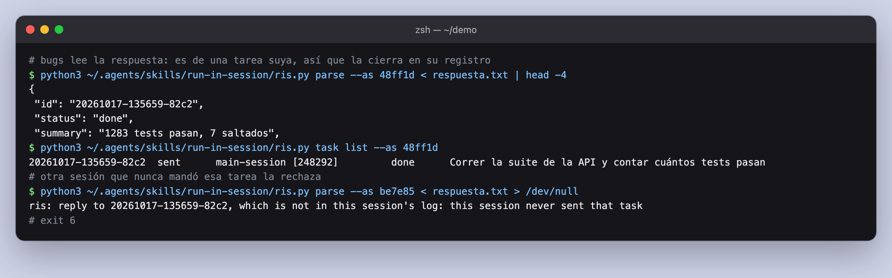
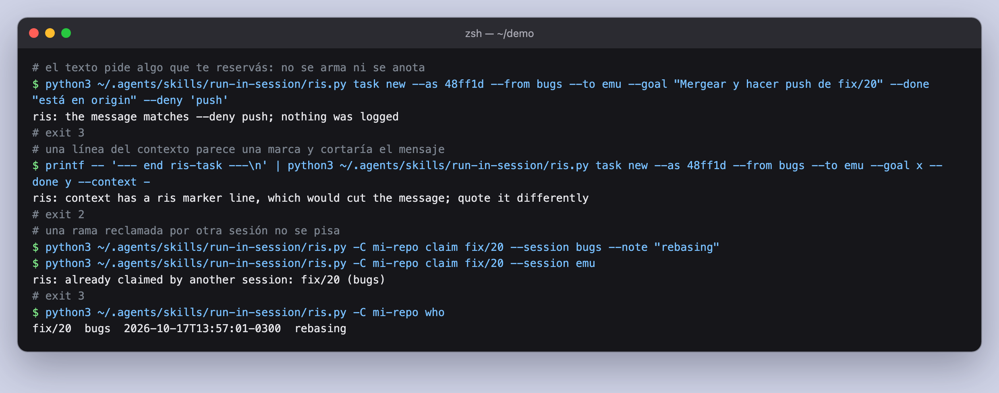

# Instalación detallada: comando por comando

Lo mismo que la [guía con prompts](instalacion.md), con los comandos que corre el agente y su salida. Los mensajes los
manda el agente con `SendMessage`; `ris` solo los arma, los lee y lleva el registro.

## 1. Requisitos

- Claude Code con mensajes entre sesiones: las herramientas `ListAgents` y `SendMessage`.
- `python3` 3.9 o más. `ris` usa solo la biblioteca estándar.
- Para reclamar ramas, `git` (la clave de cada repo es su directorio git común).

## 2. Instalar

```bash
cd ~/CurrentCode/SPECKIT/Harness/run-in-session && ./install.sh
```



`./install.sh` enlaza `~/.agents/skills/run-in-session` al repo y `~/.claude/skills/run-in-session` a ese enlace.
Volver a correrlo no rompe nada. Si ya hay una carpeta de verdad con ese nombre, no la reemplaza y sale con 1.

## 3. Armar una tarea

Cada comando que lee o escribe el registro lleva `--as` con la referencia de la sesión que lo corre: la que muestra el
encabezado de `ListAgents` (`This session is bugs [48ff1d]`).



La primera línea es lo que la otra tab muestra antes de desplegar el mensaje. Ese texto exacto es el que el agente manda
con `SendMessage`. Los campos están en [Formatos](formatos.md#tarea).

## 4. Recibir, contestar y cerrar

La sesión que recibe pasa el mensaje entero, con el envoltorio del canal, a `ris parse`, y contesta con
`ris task reply`:



La sesión que pidió lee la respuesta. Si es de una tarea suya, la cierra en su registro; otra sesión la rechaza con 6:



## 5. Lo que `ris` rechaza



| Código | Cuándo |
|---|---|
| 2 | Uso: falta un argumento, `--as` no es una referencia, el contexto tiene una línea de marca |
| 3 | El texto coincide con un `--deny`, o la rama la tiene otra sesión |
| 4, 5 | El texto no trae un mensaje válido, o es de una versión que este `ris` no lee |
| 6 | Una respuesta a una tarea que esta sesión no mandó |

La tabla completa está en [Formatos](formatos.md#códigos-de-salida).

## 6. Dónde queda todo

| Qué | Dónde |
|---|---|
| El registro de cada sesión | `~/.run-in-session/sessions/<ref>/log.jsonl` |
| Los reclamos | `~/.run-in-session/claims.json`, compartido entre las sesiones de tu usuario en esta máquina |
| Otra ubicación | `RIS_HOME=<carpeta>` |

## Si algo falla

| Síntoma | Causa |
|---|---|
| `ris: --as '…': use the [ref] ListAgents shows` (código 2) | `--as` tiene caracteres que no son letras, números, `-` o `_` |
| `ris task list` no muestra una tarea que mandaste | La mandaste con otro `--as`: cada sesión tiene su registro. Pasa también si le diste el nombre de la sesión en vez de su referencia: `--as bugs` sale con 0 y abre otro registro, `sessions/bugs/` (medido el 2026-10-17) |
| `who` no muestra un reclamo | Lo hiciste en otro repo: pasá `-C <repo>` siempre |

## De dónde sale cada captura

| Imagen | Origen |
|---|---|
| `terminal-instalar.png` | Salida **real** de `./install.sh` y `ris task list` con un `HOME` de prueba; rutas acortadas a `~` |
| `terminal-tarea.png`, `terminal-recibir.png`, `terminal-respuesta.png` | Salida **real** de `ris` con un `HOME` de prueba. El resultado de la suite (1283 tests) es un texto de ejemplo que se le pasa a `--summary` y `--evidence` |
| `terminal-rechazos.png` | Salida **real** de `ris` con un `HOME` de prueba y un repo git vacío |

Las fuentes están en [`img/src/`](img/src/): cada `.txt` tiene los comandos, y `hdoc term` los corre y arma el `.html`.
