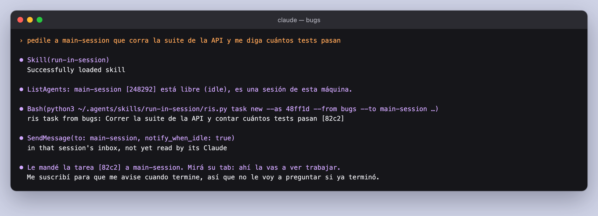
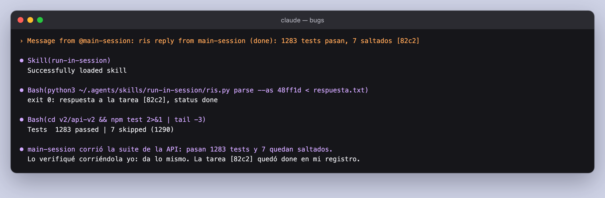

# Instalación y primer uso, conversando con tu agente

Todo se hace pidiéndoselo a Claude Code. Si preferís los comandos, está la
[instalación detallada](instalacion-detallada.md); para ver cada caso entero, el [showcase](showcase.md).

## 1. Instalar

Decile al agente:

> *«Instalá la skill run-in-session desde ~/CurrentCode/SPECKIT/Harness/run-in-session»*

Corre `./install.sh`, que enlaza la skill en `~/.agents/skills` y `~/.claude/skills`. No toca ningún repo ni ninguna
otra configuración. Una sesión abierta vio una skill recién instalada sin reiniciarse (medido el 2026-10-17 con
harness-docs); si alguna no la encuentra, cerrala y abrila de nuevo.

## 2. Darle un nombre a cada sesión

Las sesiones se buscan por el nombre que muestra `ListAgents`. En cada tab que vaya a recibir tareas escribí:

> */rename main-session*

Elegí nombres que digan qué hace cada una (`main-session`, `emu`, `bugs`). El nombre se puede cambiar cuando quieras:
la skill guarda también la referencia de la sesión (`[248292]`), que no cambia con `/rename`.

Para ver qué sesiones hay:

> *«¿Qué sesiones ves?»*

## 3. Tu primera tarea

Abrí una sesión nueva, hacele `/rename prueba-ris` y, desde otra, pedile una tarea que solo lea:

> *«Mandale a prueba-ris una tarea de prueba: que me diga el último commit de run-in-session, sin editar nada»*

El agente arma la tarea, se la manda y te dice qué tab mirar. En la tab de `prueba-ris` vas a ver el mensaje cortado en
una línea (`Message from @…: ris task from …`) y a la sesión cargando la skill sola.

*Maqueta: es el mismo recorrido que la prueba real del 2026-10-17, con una tarea de ejemplo.*

## 4. La respuesta

No hace falta que preguntes si terminó: la respuesta llega sola, como un turno nuevo, y después llega el aviso de que la
otra sesión quedó libre. El agente la lee, comprueba la evidencia y te cuenta lo que verificó.

> *«¿Qué tareas quedaron abiertas?»*

lista las que todavía esperan respuesta.

*Maqueta con datos de ejemplo.*

## 5. Reclamar una rama

Cuando varias sesiones trabajan en el mismo repo:

> *«Tomá fix/20 para esta sesión»*

Si otra sesión ya la tiene, el agente no la pisa y te dice cuál. Para soltarla:

> *«Soltá fix/20»*

## Si algo falla

| Situación | Qué hacer |
|---|---|
| El agente no encuentra la sesión | Mirá el nombre con *«¿Qué sesiones ves?»*: si la renombraste hace un momento, puede tardar en aparecer el nombre nuevo |
| La otra sesión no carga la skill | Cerrala y abrila de nuevo |
| El mensaje queda esperando en la otra tab | Según la descripción de `SendMessage` (no medido), una sesión en otro modo de permisos retiene los mensajes de otras sesiones hasta que los aprobás en su tab |
| Lo que hace para otra sesión se mezcla con lo tuyo | Lo que es para otra sesión va entre `── ris xxxx · tarea de … ──` y `── fin ris xxxx · vuelvo a lo tuyo ──`. Si llegó mientras trabajaba con vos, la sesión tendría que haberla dejado para después; pedile que termine lo tuyo primero. Del lado del que manda: *«mandásela para cuando termine»* (`--when after-current`) |
| La otra sesión contesta `declined` | La tarea le pedía algo que sus permisos no dejan o que es tuyo (push, PR, Jira): hacelo vos |
| *«no está en el registro de esta sesión»* | Llegó una respuesta a una tarea que esta sesión no mandó: el agente no actúa sobre ella |

## De dónde sale cada captura

| Imagen | Origen |
|---|---|
| `cc-mandar.png`, `cc-respuesta.png` | **Maqueta** de la tab de Claude Code, con una tarea y un resultado de ejemplo; el formato de los mensajes es el que imprime `ris` |
| `cc-recibir.png` | Reconstruida del texto **real** de la tab de `prueba-ris` del 2026-10-17; la primera línea del mensaje se actualizó al formato actual |

Las fuentes de cada captura están en [`img/src/`](img/src/): un `.txt` con lo que se muestra y el `.html` que arma
`hdoc term`.
