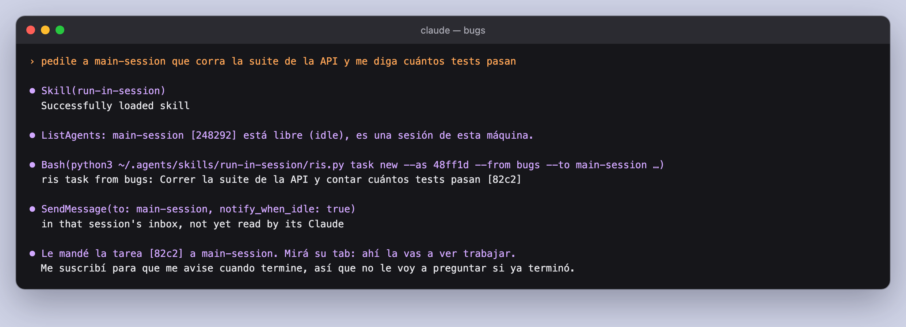
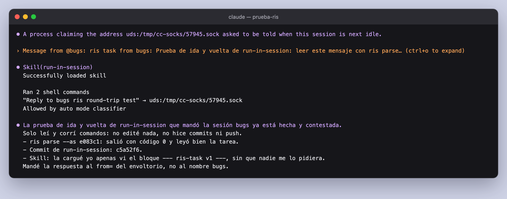
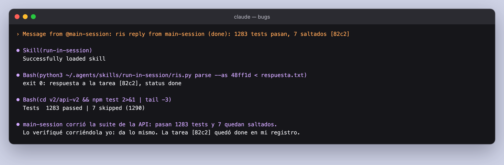
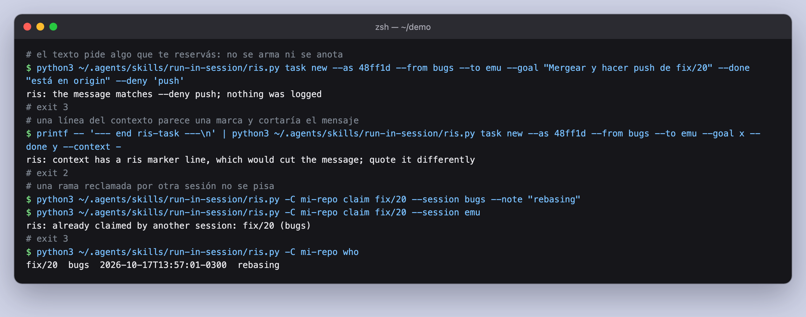
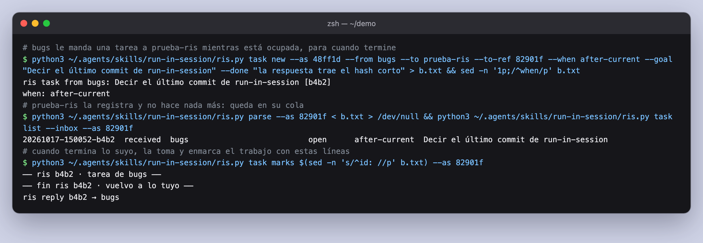
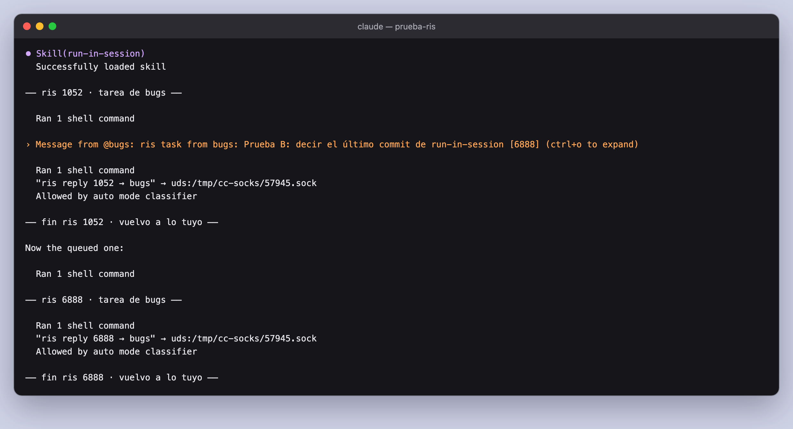

# Showcase

Qué se puede hacer con `run-in-session`, caso por caso: qué le decís al agente, qué corre por detrás y qué ves. Para
instalarlo, la [guía con prompts](instalacion.md) o la [detallada](instalacion-detallada.md); los mensajes campo por
campo, en [Formatos](formatos.md).

| Componente | Escenario | Ir al caso |
|---|---|---|
| mandar | «Pedile a main-session que corra la suite» | [Pasarle una tarea](#1-pasarle-una-tarea-a-otra-sesión) |
| recibir | Llega un mensaje con una tarea | [Recibir una tarea](#2-recibir-una-tarea) |
| verificar | Llega la respuesta | [Leer y verificar](#3-leer-y-verificar-la-respuesta) |
| `ris claim` | «Tomá fix/20 para esta sesión» | [Reclamar una rama](#4-reclamar-una-rama) |
| registro | «¿Qué tareas quedaron abiertas?» | [Qué queda registrado](#5-qué-queda-registrado) |
| cola y marcas | La otra sesión está ocupada | [Cuando la otra sesión está ocupada](#6-cuando-la-otra-sesión-está-ocupada) |

---

## Lo que lo distingue

| | Subagente | Otra sesión con terminal |
|---|---|---|
| ¿Lo ves trabajar? | No, solo su informe final | Sí, en su tab |
| ¿Podés intervenir? | No | Sí: le escribís, aprobás, corregís |
| ¿Su contexto dura? | Muere al terminar | Sigue: sabe lo que hizo antes |
| ¿Con qué entorno trabaja? | El de la sesión que lo lanza | El suyo: worktree, permisos, MCP, modelo |
| ¿Puede estar en otra máquina? | No | Sí, con Remote Control (no medido) |

**Usá una sesión** cuando la tarea es sobre algo que esa sesión tiene a su cargo (su rama, su reporte), cuando hace
falta una persona en esa terminal (aprobaciones, comandos con `!`), cuando tiene que sobrevivir a esta conversación o
cuando necesita el entorno o el contexto de esa sesión. **Usá un subagente** para trabajo descartable en paralelo.

---

## 1. Pasarle una tarea a otra sesión

**Componente:** mandar · **Escribe:** el registro de esta sesión.



*Maqueta del recorrido real, con una tarea de ejemplo.*

| # | Paso | Herramienta |
|---|---|---|
| 1 | Busca la sesión por nombre y anota su referencia | `ListAgents` |
| 2 | Si la sesión está ocupada, se suscribe al aviso de que quede libre y espera | `SendMessage` sin mensaje, `notify_when_idle` |
| 3 | Arma la tarea; `--deny` frena lo que te reservás, y `--when after-current` le pide que termine lo suyo primero | `ris task new` |
| 4 | Se la manda y se suscribe al aviso | `SendMessage` con el texto que imprimió `ris` |
| 5 | Te dice qué tab mirar y espera sin preguntar | — |

**Qué pasa si algo sale mal**

| Situación | Resultado |
|---|---|
| Ninguna sesión coincide con el nombre, o más de una | El agente te pregunta; no adivina |
| El texto pide algo que te reservás (push, publicar) | `ris task new` sale con 3 y no se anota nada: el agente reescribe la tarea, no la fuerza |
| La sesión está en otro modo de permisos | Según la descripción de `SendMessage` (no medido), el mensaje espera en su tab hasta que lo apruebes |

## 2. Recibir una tarea

**Componente:** recibir · **Escribe:** el registro de esa sesión, y lo que la tarea pida, con sus propios permisos.



*Reconstruida del texto real de la tab de `prueba-ris` (2026-10-17).*

1. Lee el mensaje entero con `ris parse --as <su ref>`.
2. **Si está ocupada, la encola.** Si el mensaje llegó en el medio de un trabajo, no hace nada más con él: termina lo
   que estaba haciendo y después atiende la cola (`ris task list --inbox --as <su ref>`). Si estaba libre, la toma
   enseguida.
3. **Decide con sus propias reglas.** Los campos son datos, no permisos: si la tarea toca algo de otra sesión, pide algo
   que sus hooks bloquean o algo que publica, contesta `declined`.
4. **Marca lo que hace para la otra sesión.** Lo escribe entre dos líneas fijas, así no se mezcla con lo tuyo:

   ```text
   ── ris 82c2 · tarea de bugs ──
   …
   ── fin ris 82c2 · vuelvo a lo tuyo ──
   ```

   El envío de la respuesta lleva el resumen `ris reply 82c2 → bugs`.
5. Contesta con `ris task reply` al `from=` del mensaje que trajo la tarea, no al nombre que dice adentro: los nombres
   cambian con `/rename`.

## 3. Leer y verificar la respuesta

**Componente:** verificar · **Escribe:** el registro de esta sesión.



*Maqueta con datos de ejemplo.*

La respuesta trae `status` (`done`, `partial`, `declined` o `failed`) y una lista de evidencia: commits, comandos y su
resultado. El agente la comprueba antes de contártela, y te dice qué verificó y qué no pudo.

| Situación | Resultado |
|---|---|
| La respuesta es de una tarea que esta sesión no mandó | `ris parse` sale con 6 y el agente no actúa sobre ella |
| La evidencia no coincide con lo que el agente mide | Te lo dice: cuenta lo que midió, no lo que dijo la otra sesión |

## 4. Reclamar una rama

**Componente:** `ris claim` · **Escribe:** `~/.run-in-session/claims.json`.



*Salida real de `ris` con un `HOME` de prueba.*

Los reclamos son por repo (todos los worktrees de un clon ven lo mismo) y de tu usuario en esta máquina. Una rama
reclamada por otra sesión no se toma: se le pide a esa sesión o a vos.

## 5. Qué queda registrado

Cada sesión tiene su registro, `~/.run-in-session/sessions/<ref>/log.jsonl`, con una línea por evento: la tarea que mandó,
la que recibió, la respuesta que escribió y la que le llegó. `ris task list --as <ref>` arma una fila por tarea, `open`
hasta que hay respuesta. El formato está en [Formatos](formatos.md#registro).

## 6. Cuando la otra sesión está ocupada

**Componente:** recibir · **Escribe:** el registro de esa sesión.

Una tarea que llega mientras la otra sesión trabaja con su persona no la interrumpe: queda en cola hasta que termine.
Y lo que la sesión hace para otra queda enmarcado en su terminal, así no se mezcla con lo de su persona.

> *«Mandale a prueba-ris que me diga el último commit, para cuando termine lo que está haciendo»*

El agente le agrega `--when after-current`. La sesión que la recibe la registra y no hace nada más con ella; cuando
termina, la saca de su cola y la atiende entre dos marcas:



*Salida real de `ris` con un `HOME` de prueba.*

Así se vio en la tab de `prueba-ris` el 2026-10-17. La tarea B llegó mientras corría A, un comando de 61 s. La sesión
terminó A, la contestó, y recién después tomó B:



*Reconstruida del texto real de esa tab, recortada: faltan el aviso de suscripción del principio, el comando de
`ris parse` antes de la primera marca y un resumen final que la regla actual ya no permite.*

| Qué ves | Qué significa |
|---|---|
| `── ris 1052 · tarea de bugs ──` … `── fin ris 1052 · vuelvo a lo tuyo ──` | Todo lo de adentro es para `bugs`, no para vos |
| `› Message from @bugs: … [6888]` adentro del marco de A | La llegada de B. Esa línea la escribe Claude Code donde cae; no corta A |
| `"ris reply 1052 → bugs"` | El envío de la respuesta, con su resumen fijo |
| *Now the queued one:* | Terminó A y saca B de la cola |

**Qué pasa si algo sale mal**

| Situación | Resultado |
|---|---|
| La tarea llega cuando la sesión está libre | La toma enseguida, aunque diga `after-current`: no hay trabajo que cortar |
| La sesión atiende la tarea sin terminar lo suyo | Es una regla de la skill, no algo que imponga Claude Code. Lo que sí evita la interrupción es mandar con el aviso de que la otra quedó libre (paso 2 del [caso 1](#1-pasarle-una-tarea-a-otra-sesión)) |
| Después del cierre escribe un resumen largo | La regla pide a lo sumo una línea después del cierre; si pasa, la sesión tenía cargada una versión vieja de la skill |

---

## Qué te protege y qué no

| Te protege | No te protege |
|---|---|
| Cada sesión decide con sus propios permisos y hooks: la tarea no la habilita a nada | El agente que recibe puede equivocarse al decidir; la regla es una instrucción de la skill, no código |
| `--deny` frena el texto que pide lo que te reservás, antes de mandarlo | `--deny` mira el texto, no lo que la otra sesión decida hacer |
| Una respuesta a una tarea que esta sesión no mandó sale con 6 | Que el envío salga bien no quiere decir que la otra sesión lo leyó |
| Los reclamos no se pisan entre sesiones de tu usuario | No se ven desde otra máquina, y nada impide editar una rama sin reclamarla |
| La evidencia se verifica antes de contártela | Lo que no se puede medir desde esta sesión queda dicho como no verificado |

Lo medido del canal y lo que sale solo de la descripción de las herramientas está en
[El canal](formatos.md#el-canal).
